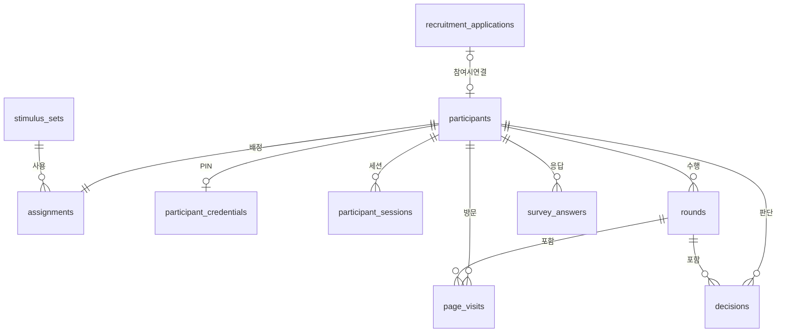

# AURA — AI 보조 의사결정 연구 웹앱

Explanation Type × Authority Cue × Task Risk가 신뢰와 행동적 의존에 미치는 영향을 살펴보는 실험 웹앱입니다.

## 실행

```sh
npm install
npm run dev
```

- 참가자 시작 화면: http://localhost:3000
- 개발용 전체 흐름: http://localhost:3000/preview
- 주소창에는 **`localhost`**를 사용하세요. `192.168.x.x` 같은 네트워크 주소는 Next.js의 개발용 스크립트 보호 때문에 로딩 화면에서 멈출 수 있습니다. 3000번 포트가 사용 중이면 터미널의 `Local:` 뒤에 표시된 포트를 사용하세요.
- 이전 미리보기 응답이 보이면 화면 아래 **처음부터** 버튼으로 새로 시작하세요.
- `npm run typecheck`: 타입 검사
- `npm run test`: 자극 계산·reliance·단계 잠금 검증
- `npm run test:browser`: 실행 중인 로컬 서버와 Chrome에서 브라우저 검증
- `npm run build`: 배포용 빌드

## 구현 상태

| 구분 | 상태 |
| --- | --- |
| 기술 | Next.js + TypeScript, Supabase, Vercel 사용 확정 |
| 디자인 원본 | [Figma 화면 디자인](https://www.figma.com/design/5ogQmEK8OAeeZ82UbKo65U/XAI---Power-Distance?node-id=355-2) |
| 기기 | PC·노트북 브라우저. Figma 기준 1440×900, 좁은 화면은 줄바꿈·스크롤 적용 |
| 설문 | Figma 원문 수령 및 화면 구현. PPD15/상황 인식4/Trust3/사후 설문 |
| 실험 흐름 | 두 라운드 전체 화면, 초기·최종 응답 분리, 제출 단계 잠금, 파일럿 서버 배정과 같은 브라우저 이어하기 |
| 파일럿 운영 | 코드+PIN, 서면 동의 확인, 서버 조건 배정, 문항별 응답·직원별 판단·화면별/전체 시간·자유 응답 저장을 `/study`에 연결. 본실험 운영과 Vercel 배포는 별도 검증 전 |
| 연구 문서 | 첨부 설명문·서면 동의서는 로컬 개발 미리보기에만 연결. 공개 저장소·배포에는 포함하지 않음 |

> `/preview`는 개발 환경에서만 열리고 입력은 연구 데이터가 아닙니다. `/study`는 **서면 동의를 대면으로 받은 파일럿 참가자**만 코드+PIN으로 사용합니다. 원본 PDF는 배포에 포함하지 않아 앱의 설명문·동의서 화면은 건너뛰며, 앱의 전체 시간은 파일럿 시작 버튼부터 종료까지입니다. 방문·설명·서명 시간까지 포함한 대면 전체 시간은 별도로 재야 합니다.

## 최신 연구 결정

- 6개 참가자 간 조건과 4개 Risk×A/B 순서를 사용합니다. 본 실험에서는 서버에서 균형 무작위 배정해야 합니다. 미리보기는 화면 점검을 위해 조건을 직접 선택합니다.
- 라운드당 직원12명. 정답상 배정5명/AURA추천5명이지만 참가자 선택 인원에는 제한이 없습니다. TP3/FP2/TN5/FN2입니다.
- 직원은 첫 판단·최종 판단에서 01~12 순서로, AURA 정보 화면에서는 추천 먼저·번호순으로 표시합니다. 첫·최종 판단에는 각각 6분, AURA 정보에는 로딩 10초가 끝난 뒤 3분의 남은 시간을 표시합니다. AURA 정보는 최소 30초 확인해야 하며, 시간이 끝나도 자동 제출하지 않습니다. 최종 판단은 빈 선택에서 시작합니다. 정답·점수는 종료 후에도 표시하지 않습니다.
- **High Risk는 사용자가 확인한 현재 Figma 설명문**을 사용합니다. 예산 관리 총괄팀 배정, 결정자 성과평가·기회와 회사 손실, 결정자 책임 기록을 포함합니다. 이전 직원 피해 중심 초안을 대체합니다.
- **유사 사례는 ‘당시 담당자의 최종 결정’만 표시**합니다. 사례의 AURA 판단·규칙상 결과는 표시하지 않습니다. 사례 FI와 네 특성값은 유지합니다.
- 직원24명/사례32개 수치 v2는 파일럿 검토용입니다. 사례 표시 v3의 `historicalDecision`은 가상 담당자 결정이며, 초안에서는 각 사례의 규칙상 결과와 일치하도록 설정했습니다. 실제 사람의 관측 응답이 아닙니다.
- 파일럿은 본 분석과 분리합니다. 최종 표본·제외 기준·채점은 이후 확정합니다.

## 확인한 내용

타입 검사·배포용 빌드, 실험 규칙 테스트 7개, 전체 흐름/6조건 브라우저 테스트 2개를 통과했습니다. PIN 인증과 파일럿 흐름을 임시 참가자로 브라우저→API→DB까지 검증했습니다. 파일럿 검증에서는 설문 원응답 39개, 직원 판단 48개, 화면 시간 19개, 전체 완료 시각과 자유 응답을 확인하고 임시 참가자 자료를 삭제했습니다. Chrome 1440×900·1366×768·1920×1080에서 가로 넘침을 확인했고, 배포용 `/preview`는 404로 생성됩니다.

## 자료와 다음 연결 작업

| 파일 | 역할 |
| --- | --- |
| [AGENTS.md](AGENTS.md) | 연구 설계·확정 사항·Codex 작업 기준 |
| [Figma 원문](src/content/figma-source.json) | 화면 ID와 문항·선택지·시나리오 원문 |
| [수치 자료](src/content/stimuli-v2.json) | 직원/사례의 특성값·기여도·결과 및 표시 버전 |
| [노션용 명세](exports/AURA_배정_판단_설명_명세_노션.md) | 이전 수치안 검토용 내보내기. 최신 표시 변경은 AGENTS 우선 |

본실험 전 필요한 결정: 채점·제외 기준, 개인정보 보관·접근 설정, 다른 브라우저 재접속 방식입니다. 기본 정보 화면에는 나이 항목이 없어 임의로 추가하지 않았습니다. Figma의 문항 오탈자도 그대로 보존했습니다.

### Supabase 프로젝트 생성 설정

| 생성 화면 항목 | AURA 권장 입력 |
| --- | --- |
| Organization | 기존 `My Research (FREE)` 선택 |
| GitHub (optional) | 생성 단계에서는 연결 생략. DB 스키마 변경을 코드로 관리할 준비가 되면 별도로 연결 |
| Project name | `aura-research` |
| Database password | 자동 생성한 강한 비밀번호를 비밀번호 관리자에 보관. Git·문서·채팅에 붙여 넣지 않음 |
| Region | `Need a specific region?`에서 `Northeast Asia (Seoul)` 선택. `Auto`는 사용하지 않음 |
| Enable Data API | 켬. 이후 `supabase-js`를 쓰는 서버 API에서 필요한 테이블만 접근 |
| Automatically expose new tables | 끔. 필요한 테이블과 권한만 명시적으로 설정 |
| Enable automatic RLS | 켬. 공개 스키마의 새 테이블에 자동 적용하고, 실제 정책·권한도 별도로 확인 |
| Advanced Configuration | 지금은 기본값 유지 |

> `aura-research` 프로젝트는 서울 리전에 생성됐고 테이블·접근 제한·PIN 인증 구조를 2026-11-02에 적용했습니다. 서버 전용 키와 [클라이언트](src/lib/supabase-admin.ts) 연결은 확인했습니다. 파일럿 응답은 `/study`에서 저장하며 모집 개인정보는 아래 별도 표에 분리합니다.

### DB 초기 구조 적용

테이블·제약·접근 제한은 [초기 스키마](supabase/migrations/20261102000000_initial_experiment_schema.sql), [PIN·세션 스키마](supabase/migrations/20261102010000_participant_pin_sessions.sql), [재발급 시 세션 취소](supabase/migrations/20261102020000_revoke_sessions_on_pin_reissue.sql)에 있습니다. 원격 DB에 적용한 뒤 타입을 생성해 테이블을 확인했습니다. Publishable key로 `participants`·`survey_answers`를 조회하면 401, 비공개 모집 스키마를 조회하면 406을 반환합니다. **다른 프로젝트에 같은 구조를 재현할 때** 다음 순서로 적용합니다.

```sh
cd /Users/yein/Developer/projects/aura
npx supabase login
npx supabase link --project-ref <Project URL의 supabase.co 앞부분>
npx supabase db push --dry-run
npx supabase db push
```

`link` 과정에서 DB 비밀번호를 묻는다면 로컬 터미널에만 입력합니다. `db push --dry-run`은 적용할 마이그레이션 목록을 확인하는 단계이며 SQL 실행 검증은 실제 적용과 이후 스키마 조회로 확인해야 합니다. `supabase db reset --linked`는 원격 DB를 지우므로 사용하지 않습니다. 모집 정보는 현재 Supabase 대시보드의 `private.recruitment_applications`에 직접 입력합니다. 로컬 DB 검증은 Docker가 실행 중이지 않아 아직 하지 못했습니다.

### 참가자 코드와 일회용 PIN

참가자 번호 `PT-001`/`MT-001`은 추측할 수 있으므로 **8자리 일회용 PIN**을 함께 확인합니다. PIN은 발급 후 15분 동안만 유효하고, 5회 틀리면 15분 동안 잠깁니다. 사용한 PIN은 다시 쓸 수 없습니다. 로그인 후 같은 브라우저에는 최대 8시간 유효한 HttpOnly 세션 쿠키를 둡니다. PIN 재발급 시 이전 세션은 취소됩니다. PIN 원문은 DB에 저장하지 않습니다.

```sh
cd /Users/yein/Developer/projects/aura
npm run participant:issue -- pilot
npm run participant:issue -- main
npm run participant:issue -- --reissue PT-001
npm run participant:confirm -- PT-001
npm run pilot:report
```

위 명령은 **진행자만** 실행합니다. 참가자 코드와 PIN은 터미널에 한 번 표시되므로 대면 전달하고 채팅·GitHub에 올리지 않습니다. 파일럿에서는 먼저 대면으로 설명하고 서면 동의를 받은 뒤 `participant:issue -- pilot`로 코드와 PIN을 발급하고, **실제 서명을 확인한 경우에만** `participant:confirm`을 실행합니다. 참가자는 `/`에서 로그인하고 `/study`를 시작합니다. `pilot:report`는 파일럿 코드별 앱 전체 시간·화면별 시간·자유 응답을 터미널에 보여줍니다. 본실험용 `main` 발급은 아직 운영하지 않습니다.

### 실제 운영 데이터 설계 초안 (ERD)

`/preview`의 브라우저 저장은 아래 DB 구조를 구현한 것이 아닙니다. 실제 운영에서는 모든 응답을 서버에서 참가자 UUID에 연결하고, 참가자 코드만 화면에 보여줍니다.



`recruitment_applications`는 Data API에 공개하지 않는 `private` 스키마에, 나머지는 연구 응답용 테이블에 둡니다. `survey_answers` 중 PPD·기본 정보·사후 설문은 라운드가 없으므로 `round_no = NULL`입니다. 위 그림에서 `rounds`와 `survey_answers`를 필수 관계로 연결하지 않은 이유입니다.

| 테이블 | 한 행의 의미 | 주요 저장 항목 |
| --- | --- | --- |
| `private.recruitment_applications` | 모집 신청 1건 | 연락처·생년월일(필요한 경우)·예약 일시·신청 상태·선택적 참가자 연결. 연구 응답과 접근 권한을 분리 |
| `participants` | 참가자 1명 | 내부 UUID, 표시 코드, `pilot/main` 구분, 진행 상태, 서면 동의 확인 여부·문서 버전·확인 시각, 시작·완료 시각 |
| `participant_credentials` | 참가자별 현재 PIN 1개 | PIN 해시·만료·사용 시각·실패 횟수·잠금 시각. 원문 PIN은 저장하지 않음 |
| `participant_sessions` | 로그인 세션 1개 | 임의 토큰의 해시·참가자·만료·취소 시각. 쿠키 원문은 저장하지 않음 |
| `assignments` | 참가자별 1회 배정 | Authority Low/High, Explanation None/FI/Case, 네 가지 라운드 순서 중 하나, 자극 자료 버전, 배정 시각 |
| `rounds` | 참가자의 Risk 라운드 1개 | 1/2번 라운드, Low/High, 직원 묶음 A/B, 시작·종료 시각 |
| `page_visits` | 화면에 들어올 때마다 1행 | 화면 이름, 라운드, 진입·이탈·마지막 접속 시각, 실제 보이는 동안의 시간 `active_ms`, 전체 경과 `wall_ms`, 이탈 사유. 재방문은 새 행 |
| `survey_answers` | 설문 문항별 응답 1개 | 문항 묶음, 선택적 라운드 번호, 원본 Figma 문항 ID, 숫자 선택 또는 자유서술, 답변 시각. 수정 전 선택 이력은 필요할 때만 추가 |
| `decisions` | 직원 1명에 대한 한 단계의 확정 판단 | 라운드, 직원 ID, `initial/final`, 배정 1·보류 0, 선택·제출 시각. AURA 판단·정답은 자극 버전으로 연결 |
| `stimulus_sets` | 고정된 실험 자료 버전 1개 | 직원·유사 사례 수치와 AI 판단·정답·FI 값의 원본, 버전, 해시 |

**표기:** `PK`는 각 행을 구별하는 고유값, `FK`는 다른 테이블의 행을 가리키는 연결값입니다. 아래 컬럼은 적용된 DB 구조를 쉽게 설명한 것입니다. 실제 컬럼명과 제약은 마이그레이션 파일이 기준입니다.

#### 1. `participants` — 참가자 기본 기록

| 컬럼 | 뜻과 예시 |
| --- | --- |
| `id` (PK, UUID) | 시스템 내부 식별자. `PT-001` 같은 표시 코드와 별도로 생성합니다. 모든 응답을 연결하는 기준입니다. |
| `participant_code` (고유) | 참가자가 입력하는 코드. 파일럿 `PT-001`, 본 실험 `MT-001`처럼 중복 없이 발급합니다. |
| `phase` | `pilot` 또는 `main`. 코드 앞글자와 별도로 저장해 파일럿 자료를 분석에서 확실히 분리합니다. |
| `status` | 발급됨·진행 중·완료·중단·참여 거절 중 현재 상태. 재접속과 완료 여부 판단에 사용합니다. |
| `consent_document_version` | 실제 대면 서면 동의서의 승인본 버전. 어떤 문서로 동의를 받았는지 남깁니다. |
| `paper_consent_confirmed_at` | 진행자가 서면 동의를 확인한 시각. 미리보기 화면의 라디오 클릭으로 채우지 않습니다. |
| `started_at`, `completed_at` | 실험 시작·완료 시각. 둘의 차이는 전체 **경과 시간**이며, 중도 종료면 `completed_at`은 비어 있습니다. |
| `created_at` | 코드가 발급되어 행이 생성된 시각. |

모집 단계의 이름·연락처·예약 정보는 이 실험 응답 테이블에 넣지 않습니다. 참가자와 연결해야 할 때는 표시 코드 대신 내부 UUID를 사용하고, 분석 자료에는 연락처 연결 정보를 내보내지 않습니다.

`participant_credentials`와 `participant_sessions`는 인증용 별도 테이블입니다. 브라우저의 공개 키에는 접근 권한이 없으며 연구 분석 자료에도 포함하지 않습니다.

| 인증 테이블·컬럼 | 뜻 |
| --- | --- |
| `participant_credentials.participant_id` | PIN이 발급된 참가자의 내부 UUID. 참가자별 현재 PIN 1개만 둡니다. |
| `pin_digest`, `pin_expires_at`, `pin_used_at` | PIN을 서버에서 변환한 값, 만료 시각, 사용 시각. 원문 PIN은 저장하지 않습니다. |
| `failed_attempts`, `locked_until`, `issued_at` | 잘못 입력한 횟수, 잠금 종료 시각, 최근 발급 시각. |
| `participant_sessions.token_digest`, `participant_id` | 브라우저 쿠키의 임의 토큰을 변환한 값과 해당 참가자. |
| `created_at`, `expires_at`, `revoked_at` | 세션 생성·만료·취소 시각. 만료 또는 취소된 세션은 사용할 수 없습니다. |

#### 2. `private.recruitment_applications` — 모집 신청과 예약

| 컬럼 | 뜻과 예시 |
| --- | --- |
| `id` (PK, UUID) | 신청 자체의 내부 식별자. 아직 참가자 코드를 발급하지 않아도 만들 수 있습니다. |
| `name`, `phone`, `email` | 신청자의 이름과 연락처. 실제 모집에 필요한 항목만 수집합니다. |
| `birth_date` | 생년월일이 승인된 모집 문서와 운영에 필요한 경우에만 저장합니다. 출생연도만 필요하면 연도만 수집합니다. |
| `reserved_at` | 실험 예약 날짜와 시간을 담는 `timestamptz`. 화면에서는 한국 시간(`Asia/Seoul`)으로 표시합니다. |
| `status` | 신청·예약 확정·취소·참석·불참 등 모집 진행 상태. |
| `participant_id` (선택적 고유 FK) | 실제 참여해 코드가 발급된 뒤 `participants.id`와 연결합니다. 신청만 하고 참여하지 않았다면 `NULL`입니다. |
| `created_at`, `updated_at` | 신청 생성·마지막 변경 시각. |

> **접근:** 이 테이블은 Supabase의 Data API에 노출하지 않는 `private` 스키마에 두고, 연구자용 서버 경로의 서버 전용 Postgres 연결 또는 승인된 관리 절차에서만 접근합니다. 브라우저에는 DB 비밀번호나 관리자 비밀키를 보내지 않습니다. 모집 정보의 수집 항목·보관 기간·삭제 시점은 최종 승인된 연구 문서에 맞춰 확정합니다. 기관이 외부 클라우드 보관을 허용하지 않는다면 기관 승인 저장소에 두고 앱에는 참가자 UUID만 연결합니다.

#### 3. `assignments` — 실험 조건 배정

| 컬럼 | 뜻과 예시 |
| --- | --- |
| `participant_id` (PK·FK) | `participants.id`와 연결합니다. 한 사람에게 배정 행은 하나입니다. |
| `authority_cue` | `low` 또는 `high`. AI를 참고용/공식 지정 시스템 중 어떻게 제시했는지입니다. |
| `explanation_type` | `none`, `fi`, `case`. 설명 없음·특성별 기여도·기여도+유사 사례 중 하나입니다. |
| `sequence_code` | 네 가지 Risk×직원 묶음 순서 중 하나. 예: `A-L → B-H`. 재접속 때 다시 뽑지 않습니다. |
| `stimulus_version` (FK) | 사용한 `stimulus_sets.version`. 당시 직원 수치·정답·AI 결과를 복원할 수 있게 합니다. |
| `assigned_at` | 서버가 조건을 **한 번만** 배정한 시각. 중복 요청에도 같은 배정을 반환해야 합니다. |

#### 4. `rounds` — 두 번의 판단 과제

| 컬럼 | 뜻과 예시 |
| --- | --- |
| `participant_id` (FK), `round_no` | 누구의 몇 번째 라운드인지. `round_no`는 1 또는 2이며 두 값을 함께 고유하게 관리합니다. |
| `risk_level` | 해당 라운드의 `low`/`high`. 두 Risk를 각각 한 번 경험합니다. |
| `form_code` | 해당 라운드의 직원 묶음 `A`/`B`. 같은 묶음을 반복하지 않습니다. |
| `started_at`, `completed_at` | 라운드 시작·종료 시각. 중단된 라운드는 종료 시각이 비어 있습니다. |

#### 5. `page_visits` — 화면별 시간

| 컬럼 | 뜻과 예시 |
| --- | --- |
| `id` (PK), `participant_id` (FK) | 이 화면 방문의 고유값과 참가자. 같은 화면을 다시 열면 새 방문 행을 만듭니다. |
| `round_no` | 라운드 화면이면 1/2, 공통 시작·마무리 화면이면 비어 있습니다. |
| `page_key` | `demographics`, `ppd`, `scenario`, `browse`, `initial`, `loading`, `advice`, `final`, `trust`, `post` 등 안정적인 화면 이름. |
| `entered_at`, `left_at` | 화면에 들어온 시각과 다음 화면으로 나간 시각. 브라우저가 갑자기 닫히면 이탈 시각은 비어 있을 수 있습니다. |
| `last_seen_at` | 화면이 열린 동안 주기적으로 서버에 남기는 마지막 접속 시각. 갑작스러운 종료 시 확인 가능한 마지막 지점입니다. |
| `wall_ms` | 진입부터 이탈까지의 전체 밀리초. 탭이 숨겨진 시간도 포함합니다. |
| `active_ms` | 화면이 실제로 보인 동안의 밀리초. 숨긴 탭·중단 시간을 빼고 누적합니다. |
| `exit_reason` | 다음 단계·이전 화면 확인·새로고침·재접속·중단 등 방문이 끝난 이유. |

#### 6. `survey_answers` — 설문 원응답

| 컬럼 | 뜻과 예시 |
| --- | --- |
| `id` (PK), `participant_id` (FK) | 문항 응답의 고유값과 참가자. |
| `round_no` (NULL 허용) | Risk 확인·Trust처럼 라운드별 문항이면 1/2, 기본 정보·PPD·마무리 설문이면 `NULL`입니다. `0`을 대신 넣지 않습니다. |
| `instrument` | `demographics`, `ppd`, `risk_check`, `trust`, `manipulation_check`, `accuracy`, `umux`, `free_text` 등 문항 묶음. |
| `question_key` | 앱 안에서 바뀌지 않는 문항 키. 예: `gender`, `ppd_01`, `accuracy`. |
| `figma_node_id` | 피그마 원문 문항의 노드 ID. 화면에 없는 내부 문항이라면 비울 수 있습니다. |
| `answer_number` | 선택지 번호(예: 1~5·1~7), 또는 체감 정확도 값(0~100, 5단위). 자유서술이면 비웁니다. |
| `answer_text` | 자유서술 원문. 숫자 선택 문항이면 비웁니다. |
| `updated_at`, `submitted_at` | 마지막으로 답을 바꾼 시각과 해당 설문 화면을 확정한 시각. 확정 후 수정은 막습니다. |

선택지 번호만으로 해석이 달라지지 않도록 **문항·선택지 버전**도 고정합니다. 특히 PPD·Trust 점수는 원응답을 보존한 채 분석할 때 계산합니다.

`round_no`가 1/2인 응답은 해당 참가자의 실제 `rounds` 행과 일치해야 합니다. `NULL`인 응답도 `participant_id`로 참가자에게 연결되므로 누락되지 않습니다.

#### 7. `decisions` — 직원별 첫·최종 판단

| 컬럼 | 뜻과 예시 |
| --- | --- |
| `participant_id` (FK), `round_no`, `employee_id`, `stage` | 누가·몇 번째 라운드에서·어느 직원에게·첫 판단(`initial`) 또는 최종 판단(`final`)을 했는지. 네 값을 함께 고유하게 관리합니다. |
| `choice` | 참가자가 확정한 `1=배정`, `0=보류`. **미응답은 행이 없거나 별도 NULL**로 구분합니다. |
| `selected_at` | 해당 직원의 마지막 선택 시각. |
| `submitted_at` | 12명 판단을 모두 확정한 시각. 첫 판단을 제출한 뒤에는 값이 바뀌지 않습니다. |

한 참가자가 두 라운드를 완료하면 직원 12명 × 첫·최종 판단 2단계 × 2라운드로 **최대 48행**입니다. AURA 판단·정답·FI 값은 참가자 선택과 섞지 않고 `stimulus_sets`에서 읽습니다.

#### 8. `stimulus_sets` — 직원·AI 자료의 고정본

| 컬럼 | 뜻과 예시 |
| --- | --- |
| `version` (PK) | 실험 자료 버전. 파일럿 수정과 본 실험 확정본을 구별합니다. |
| `sha256` | 파일 내용이 바뀌지 않았는지 확인하는 해시값. |
| `payload` | A/B 직원 특성값, 정답, AURA 추천·FI, 연결된 유사 사례와 해당 사례 값을 담은 고정 JSON. 참가자별로 반복 저장하지 않습니다. |
| `created_at` | 자료 버전을 등록한 시각. |

유사 사례는 FI 아래 자동으로 표시되고 별도 열기 동작이 없으므로 `content_views` 테이블은 만들지 않습니다. AI 추천 정보 화면의 체류 시간은 `page_visits`에 기록합니다. 이 시간만으로 개별 사례를 실제로 읽었다고 해석하지 않습니다.

> **시간 기록:** 01~14 화면과 로딩 화면을 각각 기록합니다. 다음 화면으로 넘어갈 때 진입·이탈 시각과 소요 시간을 확정하고, 페이지가 열린 동안에는 주기적으로 `last_seen_at`과 보이는 시간을 저장합니다. 숨긴 탭의 시간은 `wall_ms`에만 넣고 `active_ms`에서는 뺍니다. 전체 경과는 시작~완료 시각, 전체 활동 시간은 각 방문의 `active_ms` 합계로 계산합니다. 브라우저가 갑자기 종료되면 마지막 접속 시각까지만 확인할 수 있으므로 미완료 방문으로 구분합니다.

| 화면 | 저장할 내용 |
| --- | --- |
| 01 참가자 번호 | 코드+PIN 확인과 세션 발급. 이름·전화번호는 실험 응답과 함께 저장하지 않음 |
| 02 설명문·03 동의서 | 각각의 방문 시간, 서면 동의 확인 기록과 문서 버전. 미리보기 라디오 선택은 실제 서명이 아님 |
| 04 기본 정보·05 사전 설문 | 성별·학력·AI 사용 경험, PPD 15문항. 나이는 현재 화면에 없음 |
| 06 상황 설명·07 상황 인식 | 시나리오 Risk·직원 묶음, 네 가지 상황 인식 응답, 화면별 시간 |
| 08 직원 열람·09 첫 판단 | 열람 시간, 직원 12명에 대한 첫 배정/보류 응답과 확정 시각 |
| 로딩·10 AURA 정보·11 최종 판단 | 로딩 10초와 AURA 화면 시간을 따로 기록, 조건·자극 버전, 직원 12명 최종 판단 및 시각 |
| 12 판단 경험·13 마무리 설문·14 종료 | 라운드별 Trust 3문항, 사후 조작 확인 3문항·체감 정확도(0~100%, 5% 간격)·UMUX-Lite 2문항·자유서술, 완료 시각 |

RAIR·RSR·과신/과소의존은 `decisions`의 첫·최종 판단과 버전이 고정된 AURA 판단·정답으로 **분석할 때 계산**합니다. 원자료에는 직원별 응답과 조건부 분모를 다시 계산할 수 있는 자극 버전을 남깁니다. 실제 배정과 저장은 서버에서 한 번만 처리하고, 참가자에게 다른 사람의 행을 읽거나 쓰는 권한을 주지 않습니다.

**참가자 코드 확정:** 파일럿 `PT-001`, `PT-002`… / 본 실험 `MT-001`, `MT-002`…. DB에는 `phase`도 별도로 저장하고 두 집단을 기본 분석에서 분리합니다. 코드는 공개 화면의 식별자일 뿐 인증 수단으로 단독 사용하지 않고, 대면 진행자가 확인한 참가자에게만 발급합니다. PIN은 15분 유효하고 재발급하면 기존 세션은 취소됩니다.

### 로컬 연구 문서

첨부받은 PDF는 `data/private/documents/participant-information.pdf`와 `data/private/documents/written-consent.pdf`에 복사했습니다. 이 폴더는 Git에서 제외됩니다. 다른 컴퓨터에서 실행할 때는 해당 파일을 직접 복사해야 문서가 표시됩니다. PDF는 개발용 `/api/preview-document/information` 및 `/api/preview-document/consent`에서 `localhost`로 접속한 경우에만 제공됩니다. 설명문의 모집 인원 `000명`을 확정하고, 승인된 최종본을 받기 전에는 운영 화면에 게시하지 마세요.

### Supabase·Vercel 연결 순서

1. Supabase의 기존 `My Research (FREE)` 조직에 `aura-research` 프로젝트를 만들고 DB·PIN 마이그레이션을 적용했습니다. Free는 비활성 기간 후 일시 중지될 수 있으므로 본 실험 전 백업·운영 안정성에 맞춰 Pro 전환을 검토합니다. 로컬 `.env.local`에 Project URL·Publishable key·서버 전용 Secret key를 입력했습니다. 비밀키는 채팅·GitHub에 올리지 않습니다.
2. Vercel에서 **Add New → Project → Import Git Repository**로 `dev-yeinchoi/AURA`를 가져옵니다. Framework Preset은 Next.js, Root Directory는 저장소 루트입니다. 현재 연결된 Vercel 계정에는 AURA 프로젝트가 아직 보이지 않습니다.
3. Vercel의 **Project Settings → Environment Variables**에 `NEXT_PUBLIC_SUPABASE_URL`, `NEXT_PUBLIC_SUPABASE_PUBLISHABLE_KEY`, `SUPABASE_SECRET_KEY`를 Production과 Preview에 등록합니다. 마지막 키는 서버 전용 비밀 값으로만 설정하고 Git·채팅에 올리지 않습니다. 로컬에서는 `.env.local`의 같은 키를 사용합니다. 배포 후 임시 파일럿으로 로그인→설문·판단→DB 저장을 다시 검증합니다.
4. **이미 구입한 `yeinchoi.com`을 사용합니다.** `aura.yeinchoi.com`은 별도 구매가 필요한 새 도메인이 아니라 같은 도메인 아래의 서브도메인입니다. Vercel 프로젝트에 이 주소를 추가하고 안내되는 CNAME을 현재 DNS 관리 서비스에 설정합니다. 기존 `yeinchoi.com` 웹사이트와 이메일 레코드는 유지합니다. 실제 연구 개시 전까지는 Vercel Preview URL에서 검증합니다.
5. 파일럿은 `/study`에서 서면 동의 확인·서버 조건 배정·문항별 응답과 화면별 시간 저장을 사용합니다. 본실험의 분석·제외 기준, 다른 브라우저 재접속, 운영용 내보내기는 별도로 검증합니다. 파일럿 자료는 `phase = pilot`로 본실험과 분리합니다.

GitHub: https://github.com/dev-yeinchoi/AURA.git
로컬: `/Users/yein/Developer/projects/aura`

비밀 키·참가자 자료·로컬 PDF는 `.gitignore`로 제외합니다. Vercel 배포는 아직 진행하지 않았습니다.
