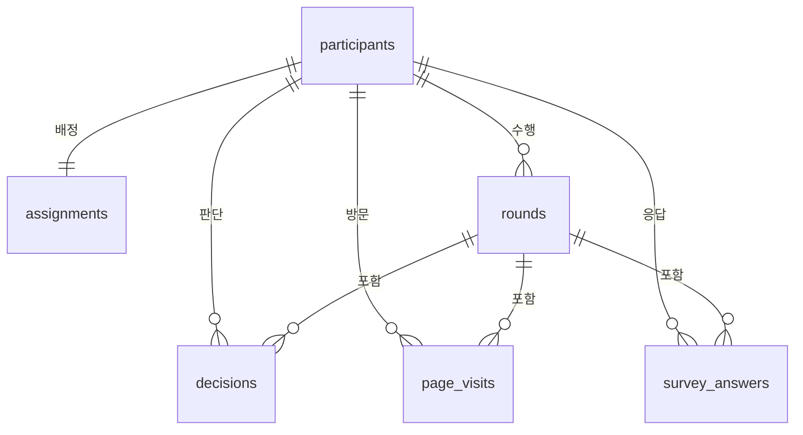

# AURA — AI 보조 의사결정 연구 웹앱

Explanation Type × Authority Cue × Task Risk가 신뢰와 행동적 의존에 미치는 영향을 살펴보는 실험 웹앱입니다.

## 실행

```sh
npm install
npm run dev
```

- 참가자 시작 화면: http://localhost:3000
- 개발용 전체 흐름: http://localhost:3000/preview
- 주소창에는 **`localhost`**를 사용하세요. `192.168.x.x` 같은 네트워크 주소는 Next.js의 개발용 스크립트 보호 때문에 로딩 화면에서 멈출 수 있습니다. 3000번 포트가 사용 중이면 터미널의 `Local:` 뒤에 표시된 포트를 사용하세요.
- 이전 미리보기 응답이 보이면 화면 아래 **처음부터** 버튼으로 새로 시작하세요.
- `npm run typecheck`: 타입 검사
- `npm run test`: 자극 계산·reliance·단계 잠금 검증
- `npm run test:browser`: 실행 중인 로컬 서버와 Chrome에서 브라우저 검증
- `npm run build`: 배포용 빌드

## 구현 상태

| 구분 | 상태 |
| --- | --- |
| 기술 | Next.js + TypeScript, Supabase, Vercel 사용 확정 |
| 디자인 원본 | [Figma 화면 디자인](https://www.figma.com/design/5ogQmEK8OAeeZ82UbKo65U/XAI---Power-Distance?node-id=355-2) |
| 기기 | PC·노트북 브라우저. Figma 기준 1440×900, 좁은 화면은 줄바꿈·스크롤 적용 |
| 설문 | Figma 원문 수령 및 화면 구현. PPD15/상황 인식4/Trust3/사후 설문 |
| 실험 흐름 | 개발용 두 라운드 미리보기, 6조건 선택, 초기·최종 응답 분리, 제출 단계 잠금, 브라우저 이어하기 |
| 실제 운영 | 참가자 조회·서버 배정·Supabase 저장·연구자 내보내기·Vercel 배포는 아직 연결 전 |
| 연구 문서 | 첨부 설명문·서면 동의서는 로컬 개발 미리보기에만 연결. 공개 저장소·배포에는 포함하지 않음 |

> `/preview`는 개발 환경에서만 열립니다. 입력은 해당 브라우저의 개발용 저장소에만 남으며 실제 연구 데이터로 사용할 수 없습니다. `/`에서 참가자 번호 확인은 아직 실제 조회를 수행하지 않습니다. 미리보기의 동의 선택은 서면 동의서의 서명을 대신하지 않습니다.

## 최신 연구 결정

- 6개 참가자 간 조건과 4개 Risk×A/B 순서를 사용합니다. 본 실험에서는 서버에서 균형 무작위 배정해야 합니다. 미리보기는 화면 점검을 위해 조건을 직접 선택합니다.
- 라운드당 직원12명. 정답상 배정5명/AURA추천5명이지만 참가자 선택 인원에는 제한이 없습니다. TP3/FP2/TN5/FN2입니다.
- 직원은 첫 판단·최종 판단에서 01~12 순서로, AURA 정보 화면에서는 추천 먼저·번호순으로 표시합니다. 첫·최종 판단에는 각각 6분, AURA 정보에는 로딩 10초가 끝난 뒤 3분의 남은 시간을 표시합니다. AURA 정보는 최소 30초 확인해야 하며, 시간이 끝나도 자동 제출하지 않습니다. 최종 판단은 빈 선택에서 시작합니다. 정답·점수는 종료 후에도 표시하지 않습니다.
- **High Risk는 사용자가 확인한 현재 Figma 설명문**을 사용합니다. 예산 관리 총괄팀 배정, 결정자 성과평가·기회와 회사 손실, 결정자 책임 기록을 포함합니다. 이전 직원 피해 중심 초안을 대체합니다.
- **유사 사례는 ‘당시 담당자의 최종 결정’만 표시**합니다. 사례의 AURA 판단·규칙상 결과는 표시하지 않습니다. 사례 FI와 네 특성값은 유지합니다.
- 직원24명/사례32개 수치 v2는 파일럿 검토용입니다. 사례 표시 v3의 `historicalDecision`은 가상 담당자 결정이며, 초안에서는 각 사례의 규칙상 결과와 일치하도록 설정했습니다. 실제 사람의 관측 응답이 아닙니다.
- 파일럿은 본 분석과 분리합니다. 최종 표본·제외 기준·채점은 이후 확정합니다.

## 확인한 내용

타입 검사·배포용 빌드, 실험 규칙 테스트 7개, 전체 흐름/6조건 브라우저 테스트 2개를 통과했습니다. Chrome 1440×900·1366×768·1920×1080에서 가로 넘침을 확인했고, 배포용 `/preview`는 404로 생성됩니다. 실제 DB 저장·서버 배정 검증은 연결 후 진행합니다.

## 자료와 다음 연결 작업

| 파일 | 역할 |
| --- | --- |
| [AGENTS.md](AGENTS.md) | 연구 설계·확정 사항·Codex 작업 기준 |
| [Figma 원문](src/content/figma-source.json) | 화면 ID와 문항·선택지·시나리오 원문 |
| [수치 자료](src/content/stimuli-v2.json) | 직원/사례의 특성값·기여도·결과 및 표시 버전 |
| [노션용 명세](exports/AURA_배정_판단_설명_명세_노션.md) | 이전 수치안 검토용 내보내기. 최신 표시 변경은 AGENTS 우선 |

실제 운영 전 필요한 결정: 설문 필수 여부/채점 기준, 개인정보 보관·접근 설정, Supabase 프로젝트 및 Vercel 연결입니다. 기본 정보 화면에는 나이 항목이 없어 임의로 추가하지 않았습니다. Figma의 문항 오탈자도 그대로 보존했습니다.

### 실제 운영 데이터 설계 초안 (ERD)

`/preview`의 브라우저 저장은 아래 DB 구조를 구현한 것이 아닙니다. 실제 운영에서는 모든 응답을 서버에서 참가자 UUID에 연결하고, 참가자 코드만 화면에 보여줍니다.



| 테이블 | 한 행의 의미 | 주요 저장 항목 |
| --- | --- | --- |
| `participants` | 참가자 1명 | 내부 UUID, 표시 코드, `pilot/main` 구분, 진행 상태, 서면 동의 확인 여부·문서 버전·확인 시각, 시작·완료 시각 |
| `assignments` | 참가자별 1회 배정 | Authority Low/High, Explanation None/FI/Case, 네 가지 라운드 순서 중 하나, 자극 자료 버전·해시, 배정 시각 |
| `rounds` | 참가자의 Risk 라운드 1개 | 1/2번 라운드, Low/High, 직원 묶음 A/B, 시작·종료 시각 |
| `page_visits` | 화면에 들어올 때마다 1행 | 화면 이름, 라운드, 진입·이탈·마지막 접속 시각, 실제 보이는 동안의 시간 `active_ms`, 전체 경과 `wall_ms`, 이탈 사유. 재방문은 새 행 |
| `survey_answers` | 설문 문항별 응답 1개 | 문항 묶음, 원본 Figma 문항 ID, 숫자 선택 또는 자유서술, 답변 시각. 수정 전 선택 이력은 필요할 때만 추가 |
| `decisions` | 직원 1명에 대한 한 단계의 확정 판단 | 라운드, 직원 ID, `initial/final`, 배정 1·보류 0, 선택·제출 시각. AURA 판단·정답은 자극 버전으로 연결 |

> **시간 기록:** 01~14 화면과 로딩 화면을 각각 기록합니다. 다음 화면으로 넘어갈 때 진입·이탈 시각과 소요 시간을 확정하고, 페이지가 열린 동안에는 주기적으로 `last_seen_at`과 보이는 시간을 저장합니다. 숨긴 탭의 시간은 `wall_ms`에만 넣고 `active_ms`에서는 뺍니다. 전체 경과는 시작~완료 시각, 전체 활동 시간은 각 방문의 `active_ms` 합계로 계산합니다. 브라우저가 갑자기 종료되면 마지막 접속 시각까지만 확인할 수 있으므로 미완료 방문으로 구분합니다.

| 화면 | 저장할 내용 |
| --- | --- |
| 01 참가자 번호 | 코드 확인 결과, 최초 접속 시각. 이름·전화번호는 실험 응답과 함께 저장하지 않음 |
| 02 설명문·03 동의서 | 각각의 방문 시간, 서면 동의 확인 기록과 문서 버전. 미리보기 라디오 선택은 실제 서명이 아님 |
| 04 기본 정보·05 사전 설문 | 성별·학력·AI 사용 경험, PPD 15문항. 나이는 현재 화면에 없음 |
| 06 상황 설명·07 상황 인식 | 시나리오 Risk·직원 묶음, 네 가지 상황 인식 응답, 화면별 시간 |
| 08 직원 열람·09 첫 판단 | 열람 시간, 직원 12명에 대한 첫 배정/보류 응답과 확정 시각 |
| 로딩·10 AURA 정보·11 최종 판단 | 로딩 10초와 AURA 화면 시간을 따로 기록, 조건·자극 버전, 직원 12명 최종 판단 및 시각 |
| 12 판단 경험·13 마무리 설문·14 종료 | 라운드별 Trust 3문항, 사후 조작 확인 3문항·체감 정확도(0~100%, 5% 간격)·UMUX-Lite 2문항·자유서술, 완료 시각 |

RAIR·RSR·과신/과소의존은 `decisions`의 첫·최종 판단과 버전이 고정된 AURA 판단·정답으로 **분석할 때 계산**합니다. 원자료에는 직원별 응답과 조건부 분모를 다시 계산할 수 있는 자극 버전을 남깁니다. 실제 배정과 저장은 서버에서 한 번만 처리하고, 참가자에게 다른 사람의 행을 읽거나 쓰는 권한을 주지 않습니다.

**참가자 코드 권장안:** 파일럿 `PIL-001`, `PIL-002`… / 본 실험 `MAIN-001`, `MAIN-002`…. DB에는 `phase`도 별도로 저장하고 두 집단을 기본 분석에서 분리합니다. 코드는 공개 화면의 식별자일 뿐 인증 수단으로 단독 사용하지 않고, 대면 진행자가 확인한 참가자에게만 발급합니다. 코드 발급·재발급·중복 입력 규칙은 운영 전 확정합니다.

### 로컬 연구 문서

첨부받은 PDF는 `data/private/documents/participant-information.pdf`와 `data/private/documents/written-consent.pdf`에 복사했습니다. 이 폴더는 Git에서 제외됩니다. 다른 컴퓨터에서 실행할 때는 해당 파일을 직접 복사해야 문서가 표시됩니다. PDF는 개발용 `/api/preview-document/information` 및 `/api/preview-document/consent`에서 `localhost`로 접속한 경우에만 제공됩니다. 설명문의 모집 인원 `000명`을 확정하고, 승인된 최종본을 받기 전에는 운영 화면에 게시하지 마세요.

### Supabase·Vercel 연결 순서

1. Supabase에서 AURA용 프로젝트를 만들고 **Connect**에서 Project URL과 Publishable key를 확인합니다. 서버에서만 쓸 Secret key는 별도로 보관하며 채팅·GitHub에 올리지 않습니다.
2. Vercel에서 **Add New → Project → Import Git Repository**로 `dev-yeinchoi/AURA`를 가져옵니다. Framework Preset은 Next.js, Root Directory는 저장소 루트입니다. 현재 연결된 Vercel 계정에는 AURA 프로젝트가 아직 보이지 않습니다.
3. Vercel의 **Project Settings → Environment Variables**에 Supabase URL·Publishable key를 등록합니다. 서버 저장 API를 구현할 때만 Secret key를 서버 전용 변수로 등록합니다. 로컬에서는 `cp .env.example .env.local` 후 같은 키 이름에 값을 넣습니다. 비밀 값은 출력하거나 커밋하지 않습니다. **현재 앱에는 DB 연동 코드가 없어 키만 입력해도 응답은 저장되지 않습니다.**
4. `aura.yeinchoi.com`을 이 Vercel 프로젝트의 Production 도메인으로 추가하고 Vercel이 안내하는 DNS 레코드를 도메인 관리 서비스에 설정합니다. 기존 `yeinchoi.com` 웹사이트와 이메일 레코드는 유지합니다. 실제 연구 개시 전까지는 Vercel Preview URL에서 검증합니다.
5. 위 ERD에 맞춰 DB 테이블·접근 제한(RLS/권한)을 만든 다음, 참가자 코드 확인·균형 배정·중간 저장·재접속·연구자 내보내기를 구현하고 파일럿 데이터와 본 실험 데이터를 분리 검증합니다.

GitHub: https://github.com/dev-yeinchoi/AURA.git
로컬: `/Users/yein/Developer/projects/aura`

비밀 키·참가자 자료·로컬 PDF는 `.gitignore`로 제외합니다. Vercel 배포는 아직 진행하지 않았습니다.
